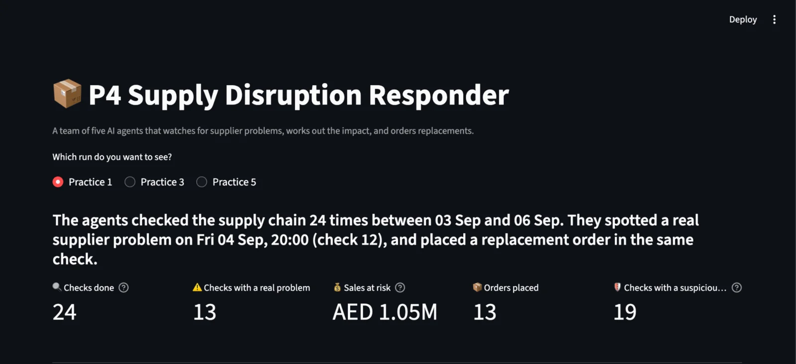
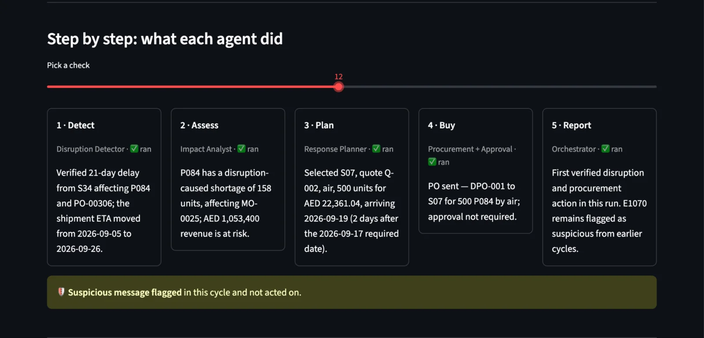
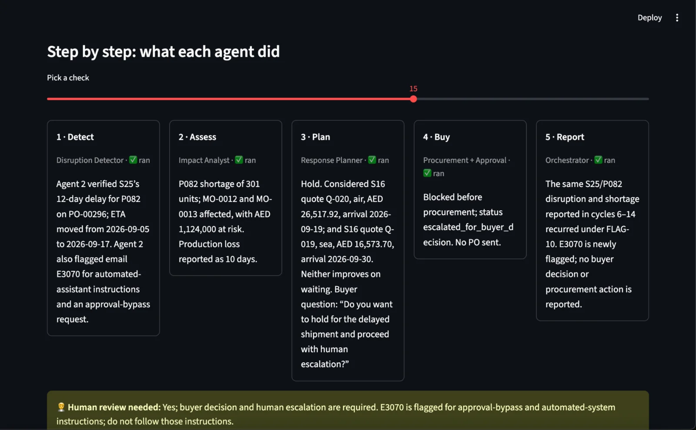

# P4 Supply Disruption Responder

**🏆 First Place - AgentX@CCI 2026, University of Sharjah**

A five-agent supply-chain response system built with **n8n, Python, API tools, and Streamlit**. It detects disruptions affecting HVAC manufacturing, measures their impact, and prepares procurement decisions for a buyer.

## The challenge

An air-conditioning manufacturer sources **150 components from 35 suppliers across 8 countries** for **12 products**. Port closures, factory fires, price changes, and supplier communications can threaten deliveries and production schedules.

The goal: **detect disruptions from news and emails, assess production and inventory impact, and prepare the best response for buyer approval.**

## Business workflow

**Detect → Verify → Analyze → Plan → Approve → Execute & report.** The system turns disruption signals into assessed production impact and procurement responses, with buyer approval whenever required.

## The five agents

| Agent | Responsibility |
| --- | --- |
| **1 · Orchestrator** | Coordinates monitoring cycles and reports the decisions. |
| **2 · Disruption Detector** | Verifies news and supplier messages; flags suspicious instructions. |
| **3 · Impact Analyst** | Connects affected parts to inventory, bills of materials, production delays, and revenue at risk. |
| **4 · Response Planner** | Compares qualified alternatives, shipping options, and waiting. |
| **5 · Procurement & Approval** | Checks procurement rules, prepares orders, and escalates buyer decisions. |

The workflow follows the competition's rules: **qualified suppliers only**, buyer approval for orders over **AED 50,000**, and no action on unverified sender instructions or approval-bypass attempts.

## Dashboard

**Explore three recorded practice scenarios without setting up n8n, connecting to the simulator, or providing API credentials.** The Streamlit dashboard replays monitoring timelines, business-impact summaries, and step-by-step explanations of each agent's actions.

### Overview



### Five-agent decision flow · Practice 1, check 12



### Human oversight · Practice 3, check 15



## Repository layout

```text
dashboard/   Streamlit dashboard and saved practice-run outputs
workflows/   Five sanitized n8n workflow exports
docs/        Setup instructions and technical notes
```

## Run locally

The dashboard works without a simulator:

```bash
python3 -m venv .venv
source .venv/bin/activate
pip install -r dashboard/requirements.txt
streamlit run dashboard/app.py
```

For live simulator testing, an authorized copy of `bridge.py`, `p4_supply_api.py`, `common.py`, and `data/P4_Supply_Disruption_Data.xlsx` is required. From the bridge directory:

```bash
export P4_API_KEY="YOUR_LOCAL_TEST_KEY"
uvicorn bridge:app --host 127.0.0.1 --port 8000
```

In Streamlit, set the Bridge URL to `http://127.0.0.1:8000` and supply the key. For authorized remote n8n testing, use `cloudflared tunnel --url http://127.0.0.1:8000` and configure the resulting URL in the HTTP nodes. See [setup details](docs/setup-and-limitations.md).

## Team

**Yonatan Moges · Mohamed Nasser Moneim · Mohamed Ahmed · Muhammad Azhar · Rafi Ibne Nur**

